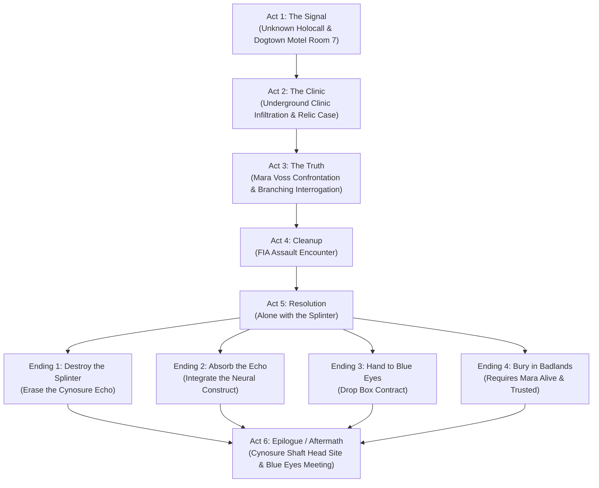

# Ash Cache — Custom Quest for Cyberpunk 2077

[](https://www.cyberpunk.net/)
[](https://www.cyberpunk.net/phantom-liberty)
[](#current-status--open-issues)
[](https://github.com/psiberx/cp2077-archive-xl)
[](#localization--voiceover)

> [!WARNING]
> **Project Status: Work In Progress (WIP) — Currently Paused / Not in Active Development**
>
> *Ash Cache* is a fully architected, multi-act custom quest mod with voice acting, scene graphs, custom 3D props, and journal phases. **Active development is currently on pause.** The repository contains the complete source JSON definitions, generator pipelines, unpacked/packed mod archives, and extensive technical documentation for developers and players interested in Cyberpunk 2077 quest modding.

---

## Table of Contents

- [Overview](#overview)
- [Story & Characters](#story--characters)
- [Quest Structure & Endings](#quest-structure--endings)
- [Features](#features)
- [Requirements & Dependencies](#requirements--dependencies)
- [Installation Guide](#installation-guide)
  - [Manual Installation](#manual-installation)
  - [Mod Manager (Vortex / MO2)](#mod-manager-vortex--mo2)
  - [Verification](#verification)
  - [Uninstallation](#uninstallation)
- [How to Play](#how-to-play)
- [Technical Architecture & Toolchain](#technical-architecture--toolchain)
  - [Directory Layout](#directory-layout)
  - [Build Pipeline](#build-pipeline)
  - [Verification & Linting](#verification--linting)
- [Localization & Voiceover](#localization--voiceover)
- [Current Status & Open Issues](#current-status--open-issues)
- [Documentation Map](#documentation-map)
- [Credits & Acknowledgments](#credits--acknowledgments)

---

## Overview

**Ash Cache** is a dark, Phantom-Liberty-toned espionage quest set in Dogtown.

V is contacted by an unknown number. During the Cynosure incident, the facility did not merely capture V's neural scan—it cultivated a predictive echo derived from it, and the FIA is moving to sanitize every trace of the evidence.

The trail begins in a derelict Dogtown motel room with an audio log from a dead courier who never opened the case he was carrying, leads into an underground ripperdoc clinic where an undercover FIA agent has guarded the secret for nine years, and culminates in a confrontation where V decides the fate of their own predictive ghost.

---

## Story & Characters

### The Cast

| Character | Role | Implementation |
|---|---|---|
| **V** | The Protagonist | `scnPlayerActorDef`, contextual dialogue actor |
| **Mara Voss** | FIA operative undercover for nine years; hid the case herself | Fully rigged custom NPC (`Character.ashcache_mara`) with custom voiceover and idle animations |
| **The Courier** | Found dead before the contract begins; speaks through his recovered log | Audio diary recording |
| **Mr. Blue Eyes** | Enigmatic observer; communicates via encrypted SMS and an in-person epilogue | Vanilla entity (`Character.q203_mr_x`), custom dialogue scene |
| **The Unknown Caller** | Triggers the quest; never identified | Holocall audio feed |
| **The Echo** | An uncanny, predictive echo grown from V's Cynosure scan | V's own vocal model |

---

## Quest Structure & Endings

The quest spans **six distinct acts**, **fifteen objectives**, and **four mutually exclusive endings**:



### The 4 Endings

1. **Destroy the Splinter (`ashcache_end_destroy`)**: Obliterate the container and permanently burn the Cynosure scan data.
2. **Absorb the Echo (`ashcache_end_absorb`)**: Jack into the splinter, integrating the predictive model into V's neural network.
3. **Surrender to Blue Eyes (`ashcache_end_blueeyes`)**: Leave the case at the clinic dead drop for Mr. Blue Eyes' agents.
4. **Bury in the Badlands (`ashcache_end_hide`)**: Gated ending requiring Mara Voss to be alive and trusted. Mara hands V the **FIA Master Key** and reveals the location of an abandoned subterranean bunker cache.

---

## Features

- **True Engine-Driven Quest Graph**: Implemented directly as native `.questphase`, `.journal`, and `.scene` resources injected into the engine root via ArchiveXL—no synthetic redscript state machines.
- **Branching Dialogue Scenes**: Fully directed multi-hub dialogue with contextual line availability depending on whether V found Mara's hidden journal shard before speaking to her.
- **Custom 3D Props & Assets**:
  - Custom Cynosure black box case (`ash_case_open`, `ash_case_closed`)
  - FIA bio-reader, echo fragments, shutdown console, and cradle models
  - Rigged corpse entities and custom workspots
- **Voice Acting & Lip Sync**:
  - Over 138 spoken dialogue lines
  - Vorbis-encoded Wwise audio banks with Audioware fallback
  - Custom face animsets and lipsync mappings
- **Dual Localization**:
  - Full English voiceover and subtitles (`en-us`)
  - Complete, human-translated Ukrainian subtitles (`ua-ua`)
- **Standalone Splinter Perk Tree**: Redscript-driven custom perks tied to the Cynosure splinter construct.

---

## Requirements & Dependencies

To play or develop *Ash Cache*, the following mods and tools are required:

| Requirement | Minimum Version | Description |
|---|---|---|
| **Cyberpunk 2077** | `v2.1` or newer | Base game |
| **Phantom Liberty** | DLC installed | Required for Dogtown access and Cynosure assets |
| [**RED4ext**](https://github.com/WopsS/RED4ext) | `v1.25.0+` | Script extender loader |
| [**ArchiveXL**](https://github.com/psiberx/cp2077-archive-xl) | `v1.14.0+` | Quest phase and resource injection |
| [**TweakXL**](https://github.com/psiberx/cp2077-tweak-xl) | `v1.10.0+` | TweakDB record modification |
| [**redscript**](https://github.com/jac3km4/redscript) | `v0.5.18+` | Redscript script compiler |
| [**Codeware**](https://github.com/psiberx/cp2077-codeware) | `v1.12.0+` | Scripted engine API extensions |
| [**Audioware**](https://github.com/psiberx/cp2077-audioware) | `v1.2.0+` | Dynamic audio bank engine (fallback) |
| [**Cyber Engine Tweaks (CET)**](https://github.com/maxime佰/CyberEngineTweaks) | Optional | Useful for testing via the dev debug panel |

---

## Installation Guide

### Manual Installation

1. Ensure all [Requirements & Dependencies](#requirements--dependencies) are installed and working.
2. Download the latest release package: `ash-cache-quest-v0.1.0-wip.zip` from the [Releases](https://github.com/0xra0/ash-cache-quest/releases) page.
3. Extract the contents of the `.zip` archive directly into your **Cyberpunk 2077 root installation folder**:
   - **GOG**: `C:\Games\Cyberpunk 2077\`
   - **Steam**: `C:\Program Files (x86)\Steam\steamapps\common\Cyberpunk 2077\`
   - **Epic**: `C:\Program Files\Epic Games\Cyberpunk 2077\`
   - **Linux / Proton**: `.../steamapps/common/Cyberpunk 2077/` or your Lutris/Heroic prefix drive.

4. Verify that the files match the following layout in your game directory:

```text
Cyberpunk 2077/
├── archive/
│   └── pc/
│       └── mod/
│           ├── ashcache.archive
│           └── ashcache.archive.xl
└── r6/
    ├── audioware/
    │   └── ash_cache/
    │       ├── ash_cache.yml
    │       └── *.wav
    ├── scripts/
    │   └── AshCache/
    │       ├── AshCacheChipData.reds
    │       ├── AshCacheChipTree.reds
    │       ├── AshCacheGlue.reds
    │       ├── AshCacheIdle.reds
    │       └── AshCacheTrophy.reds
    └── tweaks/
        └── ash_cache.yaml
```

### Mod Manager (Vortex / MO2)

1. Download `ash-cache-quest-v0.1.0-wip.zip`.
2. Install via Vortex or Mod Organizer 2 as a standard Cyberpunk 2077 mod.
3. Ensure root directory alignment matches `archive/` and `r6/`.

### Verification

Launch Cyberpunk 2077 and check the following logs:
- `r6/logs/redscript_rCURRENT.log`: Ensure `AshCache` scripts compiled without errors.
- `red4ext/logs/ArchiveXL.log`: Verify `ashcache.archive.xl` was loaded and mounted the quest phase:
  ```text
  [ArchiveXL] Merged quest phase: mod\ash_cache\quest\ash_cache.questphase -> base\quest\cyberpunk2077.quest
  ```

### Uninstallation

To cleanly remove the mod, delete the following files and folders:
- `archive/pc/mod/ashcache.archive`
- `archive/pc/mod/ashcache.archive.xl`
- `r6/tweaks/ash_cache.yaml`
- `r6/scripts/AshCache/`
- `r6/audioware/ash_cache/`
- `bin/x64/plugins/cyber_engine_tweaks/mods/ash_cache_debug/` *(if installed)*

*(Or run `tools/deploy.sh --remove` if running from source).*

---

## How to Play

1. Load any save that has completed the Phantom Liberty opening and unlocked Dogtown access.
2. Enter Dogtown. An incoming holocall from an unknown caller will ring on V's agent.
3. Accept the call to initiate **Act 1: The Signal** and receive your first journal objective.

> [!NOTE]
> For debugging or inspection, the included CET debug tool (`dev/cet/ash_cache_debug`) allows manual fact stepping and objective inspection.

---

## Technical Architecture & Toolchain

### Directory Layout

```text
.
├── source/         # Build-time single source of truth (Hand-edited JSON definitions)
├── tools/          # Python generators & pipeline toolchain (source JSON -> CR2W -> WolvenKit)
├── mod/            # Built deployable mod files (archive, tweaks, scripts, audioware)
├── docs/           # Architecture specs, design decisions, feasibility, and open issues
├── reference/      # Measurements of vanilla game resources, facts, and codex entries
├── assets/         # 3D assets (meshes, textures, materials, entities, workspots)
├── lipsync/        # Face animsets and lip sync definitions
├── narration/      # Raw audio narration recordings
├── vo/             # Voiceover recordings (en-us WEM/WAV and ua-ua subtitles)
└── dev/            # Dev-only tooling & debug overlays (never deployed to players)
```

### Build Pipeline

The quest is compiled entirely through automated scripts:

```bash
# Run the full build pipeline (source/ -> CR2W JSON -> WolvenKit CLI -> mod/)
tools/build.sh
```

The build process executes in stages:
1. **Fact & ID Allocation**: `alloc_lockeys.py` and `alloc_subtitle_ids.py` assign immutable keys.
2. **Validation**: `tools/validate.py` verifies all 66 facts, 52 journal paths, 137 LocKeys, and node connections.
3. **Resource Generation**: Python scripts emit CR2W JSON for `.questphase`, `.scene`, `.journal`, sectors, and tweaks.
4. **WolvenKit Conversion**: WolvenKit CLI serializes CR2W JSON into compiled engine binaries.
5. **Archive Packaging**: Packs `staging/` into `ashcache.archive`.
6. **Loose File Deployment**: Generates redscript glue, TweakXL YAML, and Audioware manifest.
7. **Type-Checking**: `tools/lint_glue.sh` type-checks redscript against the live game RTTI script bundle.

### Verification & Linting

```bash
# Validate source consistency
python3 tools/validate.py

# Type-check generated redscript against the compiled game bundle
tools/lint_glue.sh

# Replay test to verify graph idempotence across save reloads
python3 tools/replaytest.py

# Inspect scene dialogues and lipsync indices
python3 tools/dump_scene.py en-us
```

---

## Localization & Voiceover

- **English (`en-us`)**: Full voice acting (138 lines) trained using local RVC pipelines, encoded into Wwise Vorbis streams, with Audioware bank fallback.
- **Ukrainian (`ua-ua`)**: Complete, authentic human translation of all dialogue lines, shards, journal objectives, and terminal entries. Subtitles render over the English audio track, consistent with vanilla conventions.

---

## Current Status & Open Issues

This repository is maintained as a public reference and working snapshot.

### What is Completed & Tested
- [x] Full quest narrative, branching dialogue tree, and 15 journal objectives.
- [x] Lossless round-trip compilation through WolvenKit CLI.
- [x] Clean ArchiveXL quest phase injection into `base\quest\cyberpunk2077.quest`.
- [x] Audio voiceover, lip sync animsets, and dual-language subtitle trees.
- [x] Custom 3D meshes, textures, materials, and entity templates for props.
- [x] Redscript glue and Splinter perk data structures.

### Pending Implementation (Why it is WIP / Paused)
- **OI-13: World Interaction Entities**: 3 physical in-world devices need interactive components placed:
  - Splinter black box interactable prop at `#ac_splinter_case`
  - Ripperdoc clinic terminal interactable screen at `#ac_clinic_terminal`
  - Optional FIA-locked storage cabinet
- **OI-1: Combat Cleanup Encounter**: Wiring the FIA cleanup assault encounter spawner logic.
- **OI-9: World Placement Coordinates**: Verification of precise player standing coordinates for all world markers.

---

## Documentation Map

Detailed design and engine reverse-engineering documentation is located in the [`docs/`](docs/) directory:

- [`docs/quest_design.md`](docs/quest_design.md) — Comprehensive story breakdown, acts, character beats, and endings.
- [`docs/tech_spec.md`](docs/tech_spec.md) — Engine architecture, ArchiveXL integration, and technical rules.
- [`docs/decisions.md`](docs/decisions.md) — Detailed engineering log of every architectural decision (D1–D197).
- [`docs/feasibility.md`](docs/feasibility.md) — Empirical verification of engine limits, lossless conversions, and hooks.
- [`docs/open_issues.md`](docs/open_issues.md) — Technical backlog and known unresolved challenges.

---

## Credits & Acknowledgments

- **CD PROJEKT RED** for Cyberpunk 2077 and Phantom Liberty.
- **psiberx** for [ArchiveXL](https://github.com/psiberx/cp2077-archive-xl), [TweakXL](https://github.com/psiberx/cp2077-tweak-xl), [Codeware](https://github.com/psiberx/cp2077-codeware), and [Audioware](https://github.com/psiberx/cp2077-audioware).
- **WolvenKit Team** for the [WolvenKit](https://github.com/WolvenKit/WolvenKit) modding suite and CLI.
- **WopsS** for [RED4ext](https://github.com/WopsS/RED4ext).
- **jac3km4** for [redscript](https://github.com/jac3km4/redscript).
- **CET Team** for [Cyber Engine Tweaks](https://github.com/maxime佰/CyberEngineTweaks).
